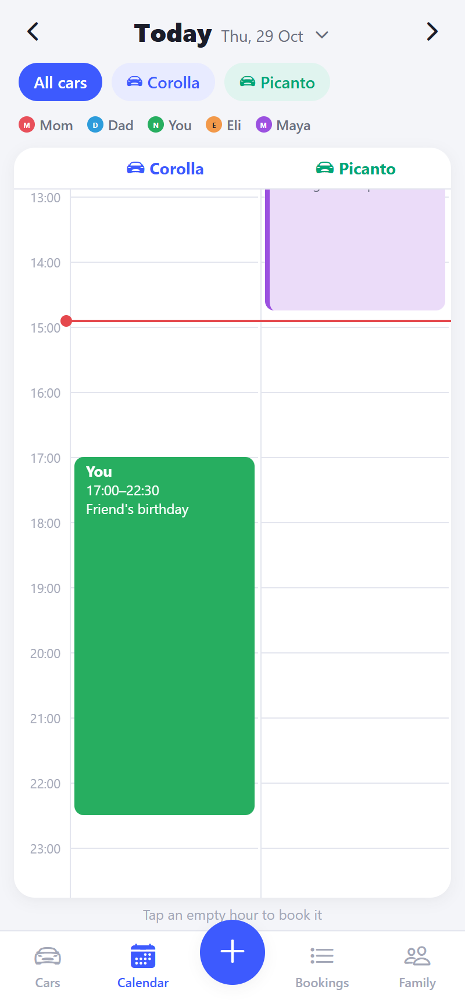
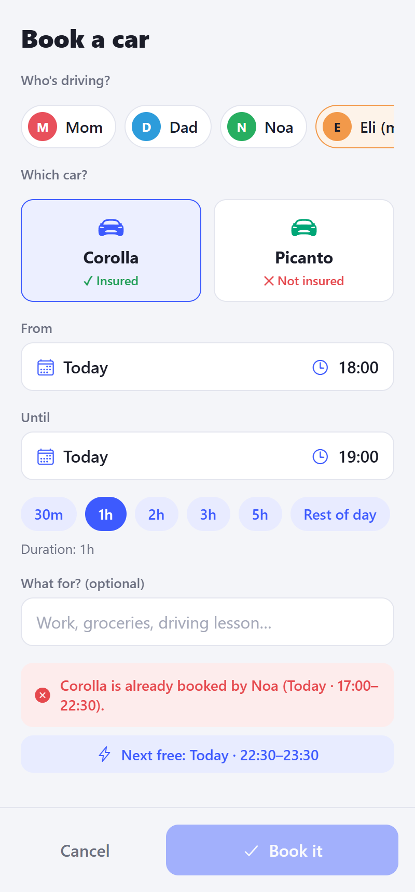
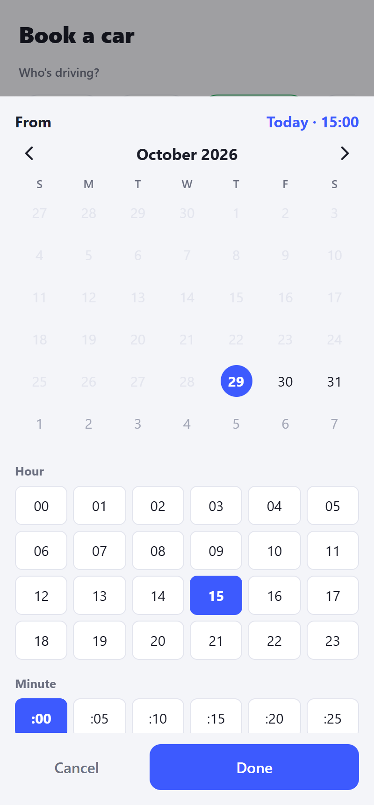

# 🚗 Family Car

**One shared calendar for the family cars — no more "who took the car?!"**

Family Car is a cross-platform mobile app (iPhone, Android and web) where every family member can see
who has each car, who is insured on it, and book it for a specific date and time, down to the minute.

Built with **React Native + Expo + TypeScript**, with optional real-time sync through **Firebase Firestore**.

---

## Features

| | |
|---|---|
| 📅 **Readable calendar** | Day view with one column per car and each booking colored by the person who made it, plus a month view with a dot for every person who has a car that day. Tap any empty hour to book it. |
| ⏱️ **Minute-precise booking** | Pick a date, an hour and exact minutes (−/+ 1 min), or use quick durations (30m, 1h, 2h, rest of day). |
| 🛡️ **Insurance rules** | Each car lists its insured drivers, insurer and expiry date. You can't book a car you're not insured on, or past the date its insurance expires. You get a warning 30 days before it expires. |
| ⚔️ **No double bookings** | Overlapping bookings are rejected, and the message says who already has the car. The app suggests the **next free slot** of the same length in one tap. |
| 🙅 **One car per person** | Nobody can hold two cars at the same time. |
| 🟢 **Live status** | "Free for 2h 6m · next: Dad at 17:00" or "Noa has it until 22:30", updated every minute. |
| 🔑 **"I'm back" return flow** | End a booking early to free the car, and leave a note: where it's parked, how much fuel is left, any problems. The next driver sees it on the car card. |
| 💬 **Ask for the car** | Message whoever has the booking straight from the app (uses the phone's share sheet). |
| 👨‍👩‍👧 **Family management** | Add or edit people and cars, choose colors, and invite family with a 6-character code. |
| 🔄 **Real-time sync** | With Firebase connected, every phone sees changes instantly. Without it, the app runs in demo mode on one device. |

## Screenshots

| Cars | Calendar | Clash + next free slot | Minute picker |
|---|---|---|---|
|  |  |  |  |

---

## Run it

Requires [Node.js](https://nodejs.org) 20+.

```bash
npm install
npm start          # then scan the QR code with the Expo Go app (iOS / Android)
npm run web        # or open it in the browser
npm test           # unit tests for the booking rules
npm run typecheck
```

Without any configuration the app starts in **demo mode**: a sample family with 2 cars and some bookings,
saved on the device. **Family → Reset demo data** restores it.

### Turn on sharing between phones (Firebase)

1. Create a free project at <https://console.firebase.google.com>, add a **Web app**, and create a **Firestore** database.
2. Copy `.env.example` to `.env` and fill in the values from the Firebase console.
3. Paste [`firestore.rules`](firestore.rules) into Firestore → Rules.
4. Restart `npm start`. The app now opens on **Create a family / Join with a code**.

### Put it on people's phones

- **Instant, no store:** everyone installs **Expo Go** and scans the QR code from `npm start`.
- **Real app install:** `npx eas-cli build --platform android` builds an installable `.apk`/`.aab`; `--platform ios` builds for the App Store or TestFlight (needs an Apple developer account).
- **Web:** `npx expo export --platform web` creates a static site you can host anywhere (Netlify, Vercel, GitHub Pages).

---

## How it works

```
App.tsx                     Onboarding → "who are you?" → 4 tabs + booking button
src/
  types.ts                  Data model: Member, Car, Booking, FamilyState
  logic/
    bookings.ts             ★ All the family rules, as pure functions
    time.ts                 Date helpers (no date library)
    __tests__/              Jest tests for the rules
  data/
    store.ts                FamilyStore interface: subscribe() + update(mutation)
    localStore.ts           Saves on the device (AsyncStorage), used for the demo
    firebaseStore.ts        Shares between phones (Firestore, real-time)
    FamilyContext.tsx       React context that gives every screen the state + actions
  components/               MonthGrid, DayTimeline, DateTimeField, shared UI
  screens/                  Home (cars), Calendar, Bookings, Family, editors
```

### Design decisions worth talking about

**1. The rules are pure functions.** Every action is a function `(state) => newState` that either returns
a new state or throws a `RuleError` with a message a person can read. This makes the rules:
- **easy to test**: no UI, no database, and a fixed `now` (see `bookings.test.ts`),
- **reusable**: the booking form runs the same `validateBooking` on every change to show "Corolla is free" or the clash *before* you press Save.

**2. Storage is behind an interface.** Screens only know `FamilyStore`. `LocalStore` and `FirebaseStore`
both implement it, so demo mode and cloud mode share 100% of the UI code. This is the strategy pattern / dependency inversion.

**3. Two people booking at the same moment.** This is a real race condition: two phones read
"Corolla is free" and both press Save. In cloud mode the whole family is **one Firestore document**,
and every change runs inside `runTransaction`. Firestore retries the losing transaction against the
fresh data, the rules run again, and the second person gets "already booked by…" instead of a
double booking. One document works because a family's data is small (well under Firestore's 1 MB limit).
`LocalStore` gets the same guarantee by chaining updates in a promise queue.

**4. Intervals are half-open `[start, end)`.** A booking ending at 10:00 doesn't clash with one starting at 10:00.

**5. Times are epoch milliseconds**, shown in the device's local time zone. Date math uses `setDate`/`setHours`
so days stay correct across daylight-saving changes. The timeline even draws 23- or 25-hour days.

**6. "Next free slot"** walks the car's bookings sorted by start time and returns the first gap long enough
for the requested duration: O(n log n) for the sort, O(n) for the scan.

### Known limitations and next steps

- **Security:** the family code works as a shared secret, and there are no user accounts yet. Next step:
  Firebase Auth (phone number or Google) with Firestore rules that check family membership.
- **Push notifications** ("Noa returned the Corolla", "your booking starts in 30 min") with `expo-notifications`.
- **Recurring bookings** ("every Sunday 8:00–9:00 to work").
- **Hebrew / right-to-left support** with `i18n`.
- **Scaling:** for very large groups, move bookings into their own collection and enforce no-overlap on a server (Cloud Function).
