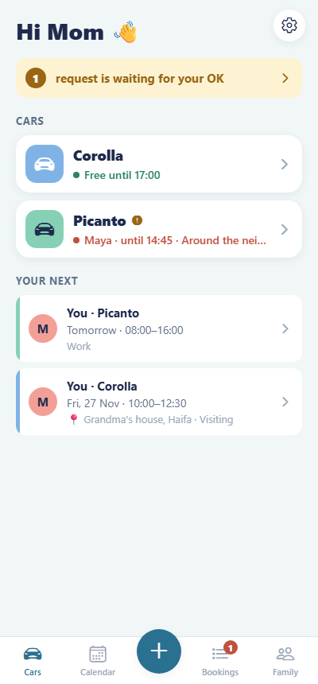
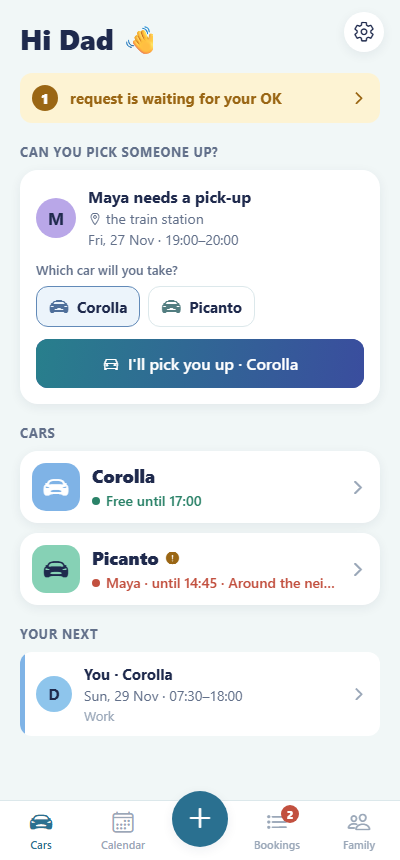
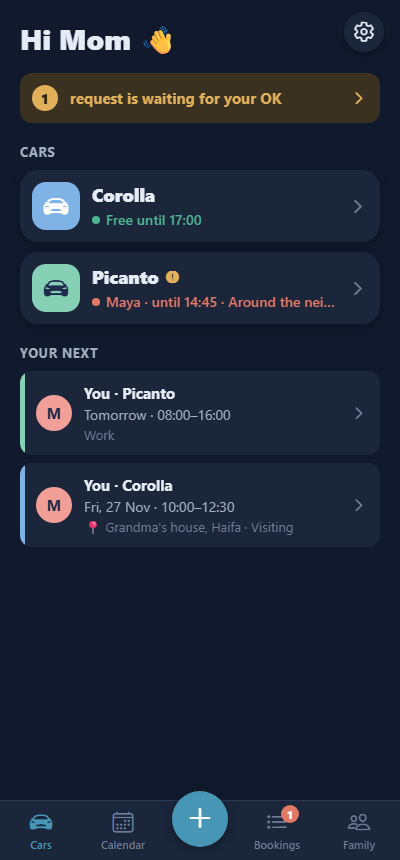
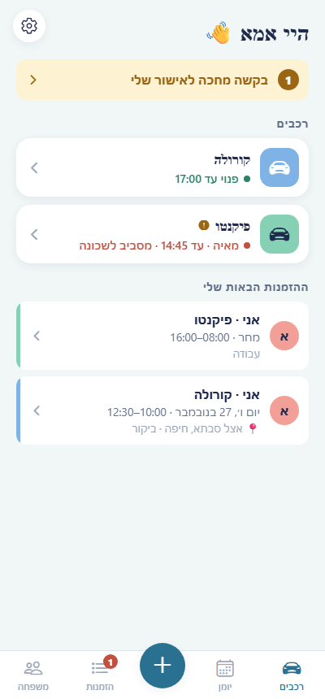
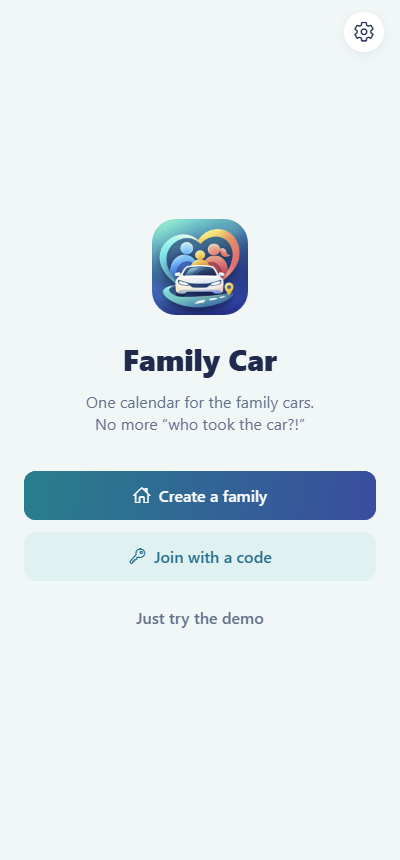

# 🚗 Family Car

**One shared calendar for the family cars — no more "who took the car?!"**

Family Car is a cross-platform mobile app (iPhone, Android and web) where every family member can see
who has each car, who is insured on it, and book it for a specific date and time, down to the minute.

Built with **React Native + Expo + TypeScript**, with real-time sync through **Firebase Firestore**.
My family uses it every day.

**Try it:** <https://family-car-b7389.web.app> → tap **Just try the demo** (a sample family, saved only in your browser).
Works in English and Hebrew (right-to-left), in light and dark mode.

---

## Features

| | |
|---|---|
| 📅 **Readable calendar** | Day view with one column per car and each booking colored by the person who made it, plus a month view with a dot for every person who has a car that day. Tap any empty hour to book it. |
| ⏱️ **Minute-precise booking** | Pick a date, an hour and exact minutes (−/+ 1 min), or use quick durations (30m, 1h, 2h, rest of day). |
| 🛡️ **Insurance rules** | Each car lists its insured drivers, insurer and expiry date. You can't book a car you're not insured on, or past the date its insurance expires. You get a warning 30 days before it expires. |
| ⚔️ **No double bookings** | Overlapping bookings are rejected, and the message says who already has the car. The app suggests the **next free slot** of the same length in one tap. |
| ✅ **Owner approval** | A car can have one or more owners (e.g. Mom and Dad). When someone else books it, the booking becomes a *request* that stays off the calendar until any owner approves it. Owners see requests on the home screen and as a badge on the Bookings tab, and can decline with a reason. Approving one request auto-declines any other requests for the same car at overlapping times. |
| 🙋 **Pick-up requests** | "Can someone pick me up from the train at 19:00?" You list the cars that are OK; everyone insured on at least one of them is asked. Nobody's car is held until someone says yes and picks a car they're insured on and that's free; only then is it booked. If the driver drops out, the request goes back to everyone. |
| 📍 **Destination** | Each booking can say where you're going. It shows in the calendar and on the car's live status, with a one-tap Waze button. |
| 🙅 **One car per person** | Nobody can hold two cars at the same time. |
| 🟢 **Live status** | "Free for 2h 6m · next: Dad at 17:00" or "Noa has it until 22:30", updated every minute. |
| 🔑 **"I'm back" return flow** | End a booking early to free the car, and leave a note: where it's parked, how much fuel is left, any problems. The next driver sees it on the car card. |
| 💬 **WhatsApp / SMS** | After you send a request, or an owner approves or declines one, the app offers a ready-written message (which you can edit) to send on WhatsApp or SMS. It goes straight to the person's saved phone number. |
| 👨‍👩‍👧 **Family management** | Invite family with a 6-character code. New people add themselves with their own PIN; returning on a new phone needs that PIN, so nobody can pretend to be someone else. The family admin manages people and cars; car owners can edit their own cars; everyone edits their own details. |
| 🌐 **Hebrew + right-to-left** | Every screen, error message, date and ready-made WhatsApp message in English or Hebrew, with the whole layout mirrored for Hebrew. |
| 🌙 **Dark mode** | System / Light / Dark, following the phone's setting live. |
| 📲 **Installable web app** | "Add to Home Screen" gives an app icon and full-screen mode; new versions reach every phone automatically the next time it's opened. |
| 🔄 **Real-time sync** | With Firebase connected, every phone sees changes instantly. Without it, the app runs in demo mode on one device. |

## Screenshots

| Cars | Calendar | Pick-up request |
|---|---|---|
|  |  |  |

| Dark mode | Hebrew (right-to-left) | Welcome |
|---|---|---|
|  |  |  |

---

## Run it

Requires [Node.js](https://nodejs.org) 20+.

```bash
npm install
npm start          # then scan the QR code with the Expo Go app (iOS / Android)
npm run web        # or open it in the browser
npm test           # 58 unit tests for the booking, pick-up and family rules
npm run typecheck
npm run deploy     # build the web app and publish it to Firebase Hosting
```

Without any configuration the app starts in **demo mode**: a sample family with 2 cars and some bookings,
saved on the device. **Family → Reset demo data** restores it.

### Turn on sharing between phones (Firebase)

1. Create a free project at <https://console.firebase.google.com>, add a **Web app**, and create a **Firestore** database.
2. Copy `.env.example` to `.env` and fill in the values from the Firebase console.
3. Paste [`firestore.rules`](firestore.rules) into Firestore → Rules.
4. Restart `npm start`. The app now opens on **Create a family / Join with a code**.

### Put it on people's phones

- **Instant, no store:** everyone installs **Expo Go** and scans the QR code from `npm start`.
- **Real app install:** `npx eas-cli build --platform android` builds an installable `.apk`/`.aab`; `--platform ios` builds for the App Store or TestFlight (needs an Apple developer account).
- **Web:** `npx expo export --platform web` creates a static site you can host anywhere (Netlify, Vercel, GitHub Pages).

---

## How it works

```
App.tsx                     Onboarding → "who are you?" → 4 tabs + booking button + settings
src/
  types.ts                  Data model: Member, Car, Booking, PickupRequest, FamilyState
  i18n.ts                   L('English', 'עברית') + right-to-left switch
  theme.ts                  Colors (CSS variables on web, so dark mode switches live)
  logic/
    bookings.ts             ★ The family rules, as pure functions
    pickups.ts              Pick-up requests: ask, take with a car, drop out
    admin.ts                Admin role, joining, per-person PINs
    messages.ts             Ready-made WhatsApp / SMS texts
    time.ts                 Date helpers (no date library)
    autoUpdate.ts           Reloads when a newer version is published
    __tests__/              Jest tests for the rules
  data/
    store.ts                FamilyStore interface: subscribe() + update(mutation)
    localStore.ts           Saves on the device (AsyncStorage), used for the demo
    firebaseStore.ts        Shares between phones (Firestore, real-time)
    FamilyContext.tsx       React context that gives every screen the state + actions
    preferences.tsx         Per-device settings: language, appearance
  components/               MonthGrid, DayTimeline, DateTimeField, PickupCard, shared UI
  screens/                  Home (cars), Calendar, Bookings, Family, editors, settings
```

### Design decisions worth talking about

**1. The rules are pure functions.** Every action is a function `(state) => newState` that either returns
a new state or throws a `RuleError` with a message a person can read. This makes the rules:
- **easy to test**: no UI, no database, and a fixed `now` (see `bookings.test.ts`),
- **reusable**: the booking form runs the same `validateBooking` on every change to show "Corolla is free" or the clash *before* you press Save.

**2. Storage is behind an interface.** Screens only know `FamilyStore`. `LocalStore` and `FirebaseStore`
both implement it, so demo mode and cloud mode share 100% of the UI code. This is the strategy pattern / dependency inversion.

**3. Two people booking at the same moment.** This is a real race condition: two phones read
"Corolla is free" and both press Save. In cloud mode the whole family is **one Firestore document**,
and every change runs inside `runTransaction`. Firestore retries the losing transaction against the
fresh data, the rules run again, and the second person gets "already booked by…" instead of a
double booking. One document works because a family's data is small (well under Firestore's 1 MB limit).
`LocalStore` gets the same guarantee by chaining updates in a promise queue.

**4. Intervals are half-open `[start, end)`.** A booking ending at 10:00 doesn't clash with one starting at 10:00.

**5. Times are epoch milliseconds**, shown in the device's local time zone. Date math uses `setDate`/`setHours`
so days stay correct across daylight-saving changes. The timeline even draws 23- or 25-hour days.

**6. Approval is a small state machine.** A booking is `pending → approved | declined`. Only approved
bookings hold the car, so a pending request can't block anyone. That's why `approveBooking` re-runs
all the rules against the latest calendar before approving. If the owner is removed or changed,
waiting requests are settled automatically so none are stuck forever.

**7. "Next free slot"** walks the car's bookings sorted by start time and returns the first gap long enough
for the requested duration: O(n log n) for the sort, O(n) for the scan.

**8. A pick-up request is not a booking.** Requests live in their own list and hold no car. Taking one
(`takePickup`) turns it into a normal booking on the car the driver chose, validated by the same rules,
inside the same transaction, so two people saying yes at once can't both win. Dropping out turns it back
into a request with the original list of cars.

**9. Two languages without a translation library.** Every string is written as `L('English', 'עברית')`, so both
languages sit side by side and neither can be forgotten. The current language is a module-level setting, so pure
logic (rule errors, dates, WhatsApp texts) can use it too; changing it remounts the app. Hebrew text avoids
gendered verbs where it can, since the app doesn't know who's reading.

**10. Dark mode with CSS variables.** On the web every theme color is a CSS custom property (`var(--c-bg)`), so
switching themes changes the variables on `<html>` instead of rebuilding every style sheet. Pastel tints use
`color-mix()` against the current background, so they don't glare at night.

**11. Caching and updates.** `index.html` is served with `no-cache`, while the bundle (whose file name is a hash of
its content) is cached for a year. Home-screen apps on iPhone can still hold an old page, so the app also compares
its bundle name with the server's when it's opened, and reloads if a newer one exists.

### Known limitations and next steps

- **Security:** the family code works as a shared secret, and there are no user accounts yet. The admin role and
  PINs are checked in the app, not on the server, and PINs are stored in the family document. Next step:
  Firebase Auth (phone number or Google) with Firestore rules that check family membership and roles.
- **Push notifications** ("Noa returned the Corolla", "your booking starts in 30 min") with `expo-notifications`.
- **Recurring bookings** ("every Sunday 8:00–9:00 to work").
- **Scaling:** for very large groups, move bookings into their own collection and enforce no-overlap on a server (Cloud Function).
